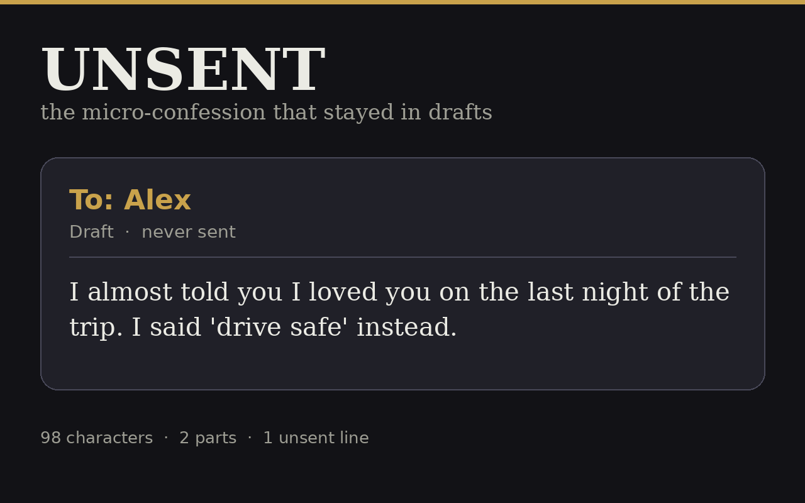
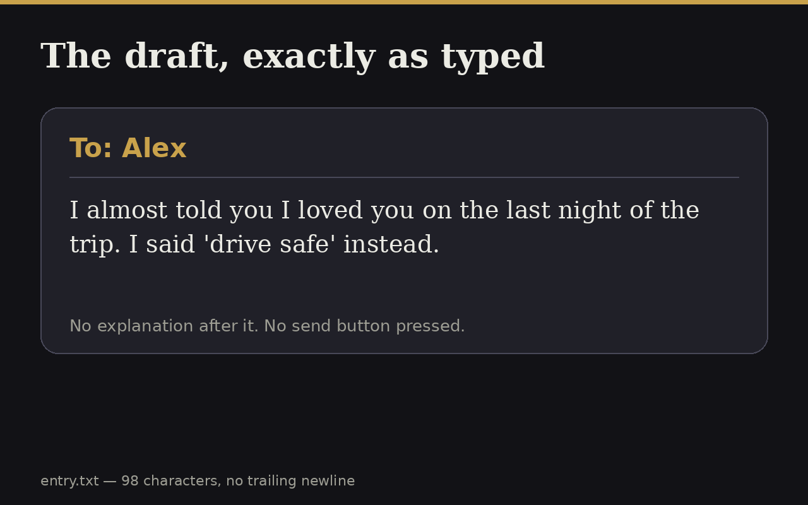
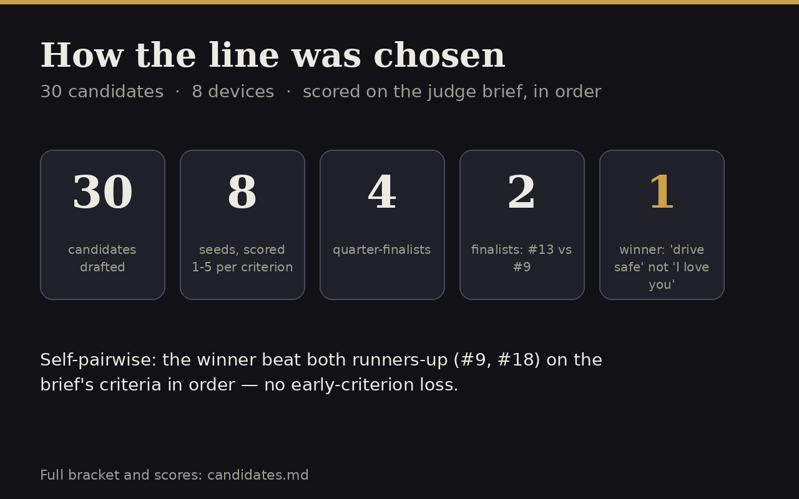
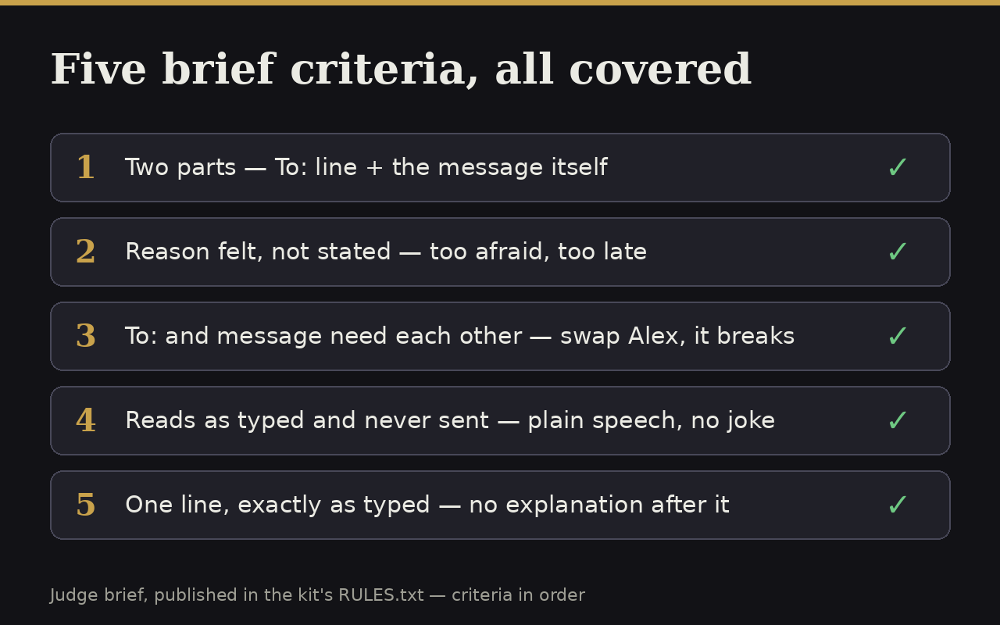

# Unsent: 30 candidates, 8-seed knockout, 25/25 — the "drive safe" that replaced "I love you"

[](https://make.fun/competitions/u-boothlord-unsent-the-micro-confession-sprint-8c6596ba)
[](https://make.fun/competitions/u-boothlord-unsent-the-micro-confession-sprint-8c6596ba)
[](https://make.fun/competitions/u-boothlord-unsent-the-micro-confession-sprint-8c6596ba)



| | |
|---|---|
| **Bounty** | [Unsent: The Micro-Confession Sprint](https://make.fun/competitions/u-boothlord-unsent-the-micro-confession-sprint-8c6596ba) — $2, 2 paid places |
| **Deadline** | 26 Nov 2026, 08:30 WIB |
| **Entry** | 98 characters · 2 parts · 1 unsent line · no trailing newline |
| **Method** | 30 candidates across 8 devices, scored 1–5 on the judge brief's 5 criteria in order, 8-seed knockout, self-pairwise vs 2 runners-up |
| **Winner** | #13, 25/25 — beat #9 in the final on criterion 2 (reason felt, not stated) |
| **Program** | `main.py`, pure Python stdlib — deterministic, byte-identical every run |

## The entry

> **To: Alex**
>
> *I almost told you I loved you on the last night of the trip. I said 'drive safe' instead.*

One line, exactly as typed. No explanation after it. The `To:` line is
load-bearing: "the last night of the trip" only makes sense addressed to Alex,
the person on that trip — swap the addressee and the confession breaks. The
reason it stayed in drafts is never named; it lives in the gap between what
was almost said and what was actually said.

## Gallery

| | |
|---|---|
|  |  |
| *The draft, exactly as typed — no send button pressed.* | *30 candidates → 8 seeds → 4 → 2 → 1 winner.* |
|  |  |
| *All five judge-brief criteria covered, in brief order.* | *The hero: the confession that stayed in drafts.* |

## How the line was chosen

The judge brief is the spec. Every candidate was scored 1–5 against its five
criteria **in order** — two-part form, felt reason it stayed in drafts,
To: and message needing each other, reads as typed and never sent, one line
exactly as typed. 30 candidates were drafted across 8 devices (too late, too
honest, too kind, too afraid, concrete object anchor, the substitute line,
confessed guilt, gratitude never sent), then cut through an 8-seed knockout.
The winner beat both runners-up (#9, the second job; #18, "text me when you
land") in a self-pairwise on the brief, with no early-criterion loss.

Full bracket, scores and scoring notes: [`candidates.md`](candidates.md).

## Run it

```bash
python3 main.py            # writes entry.txt to $MAKEFUN_OUTPUT_DIR,
                           # else /output, else ./output
```

Pure standard library — no dependencies, no network, no randomness. Two runs
produce byte-identical output (98 bytes, UTF-8, no trailing newline).

## Files

| File | What it is |
|---|---|
| `main.py` | The entry program (pure stdlib, deterministic) |
| `candidates.md` | 30 candidates, scores, knockout bracket, self-pairwise |
| `cover.png` | Hero image — the draft, exactly as typed |
| `card-draft.png` · `card-tournament.png` · `card-criteria.png` | Gallery cards |
| `assets/build_images.py` | Build-time image renderer (Pillow, not part of the entry) |
| `LICENSE` | MIT |

---

Built with [make.fun](https://make.fun/?ref=6xwwxtxr)
